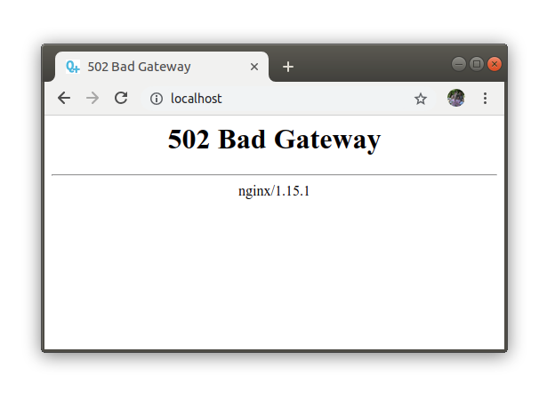

Installing & Deploying QATrack+ with Docker
===========================================

This page covers running QATrack+ with Docker Compose: setting it up,
configuring it, looking after its data and backups, running it day to day, and
developing QATrack+ with it. If you are upgrading a Docker site from QATrack+
4.0.0 or 4.0.1, start with :ref:`docker_upgrade_from_4_0`.

.. These labels keep links to section titles from older versions of this page
   working. Please keep them.

.. _windows-10-professional-or-enterprise-with-hyper-v:
.. _ensure-virtualisation-is-enabled:
.. _chocolatey:
.. _docker-for-windows-and-git:
.. _enable-shared-drives-within-docker-for-windows:

.. note::

    **Docker hosting is supported on Linux only.** You need a Linux server with
    Docker Engine 23.0 or newer and Docker Compose 2.17 or newer (see
    :ref:`docker_minimum_versions`). Running QATrack+ in Docker on Windows,
    including with Docker Desktop, is not supported. If your server runs
    Windows, follow the :ref:`Windows Server installation guide
    <win_install_40>` instead, which installs QATrack+ without Docker.

.. contents:: On this page
    :local:
    :depth: 2

.. Kept so links to an older section title still work.

.. _installing-qatrack:

.. _docker_setup:

Setting up QATrack+
-------------------

Docker installations are supported on Ubuntu 24.04 LTS, and the instructions
have also been tested on Ubuntu 22.04 LTS, the same releases as the
:ref:`Linux installation guide <linux_install_40>`. Other Linux distributions
work too, as long as they can run the Docker versions below. Work through this
section once, in order, on the server that will host QATrack+.

.. _docker_minimum_versions:

Minimum Docker versions
~~~~~~~~~~~~~~~~~~~~~~~

QATrack+ needs:

* **Docker Compose 2.17 or newer.** QATrack+'s ``compose.yaml`` passes your
  :ref:`own Python packages <docker_site_packages>` to the build in a way older
  Compose releases don't understand. With one of them, the commands that build
  or create containers (``up``, ``build``, ``run``, ``create`` and ``pull``), as
  well as ``config``, stop with:

  .. code-block:: text

      services.django.build Additional property additional_contexts is not allowed

  Containers that are already running carry on, and ``ps``, ``logs``, ``exec``,
  ``stop``, ``start`` and ``restart`` still work on them. What you can't do is
  build or start a new release, or create containers again after
  ``docker compose down``, until Docker is updated.

* **Docker Engine 23.0 or newer.** The image build relies on BuildKit features
  that Docker Engine 20.10 and earlier don't include.

Check what you have with:

.. code-block:: console

    docker compose version
    docker version --format '{{.Server.Version}}'

The first prints the Compose version (for example ``Docker Compose version
v2.27.0``) and the second the Engine version. If either is too old, update
Docker by following Docker's own instructions linked below (on Ubuntu, Docker's
``apt`` repository updates both the Engine and the ``docker-compose-plugin``
package). Docker's current releases are well above both minimums.

.. Kept so links to an older section title still work.

.. _prerequisites-by-os:
.. _ubuntu-24-04-lts:

Installing Docker and Git
~~~~~~~~~~~~~~~~~~~~~~~~~

If your server runs Ubuntu 24.04 LTS (or 22.04 LTS), follow these steps to
install the required prerequisites.

Docker Engine and Docker Compose
................................

To run this installation method you need Docker Engine with the Docker Compose
plugin, which provides the ``docker compose`` command. Install both by following
Docker's instructions for your distribution:

* `Install Docker Engine on Ubuntu <https://docs.docker.com/engine/install/ubuntu/>`__
* `Other Linux distributions <https://docs.docker.com/engine/install/>`__

Check that Compose is available, and that both meet
:ref:`the minimum versions <docker_minimum_versions>` (Compose 2.17, Engine
23.0), with:

.. code-block:: console

    docker compose version
    docker version --format '{{.Server.Version}}'

.. Kept so links to an older section title still work.

.. _make-docker-work-without-sudo-on-linux:

Running Docker without sudo
...........................

So that your own user can run ``docker`` commands without ``sudo``, follow
Docker's `post-installation steps for Linux
<https://docs.docker.com/engine/install/linux-postinstall/>`__, which add your
user to the ``docker`` group. Log out and back in (or restart the server) for
the change to take effect.

Being in the ``docker`` group is as good as being root on the server, so add
only people you would trust with root.

Before continuing please verify that you can run ``docker run hello-world`` in a
terminal.

Git
...

To retrieve files from github you will need git installed by running the
following:

.. code-block:: console

    sudo apt install git

On other systems follow the instructions at
https://www.atlassian.com/git/tutorials/install-git.

.. Kept so links to an older section title still work.

.. _changing-to-the-directory-where-all-server-files-will-be-stored:
.. _downloading:

Getting the QATrack+ code
~~~~~~~~~~~~~~~~~~~~~~~~~

As your own user (not root), choose a folder to keep QATrack+ in. This guide
uses ``~/web``, as the :ref:`Linux installation guide <linux_install_40>` does,
and fetches QATrack+ from its git repository into it:

.. code-block:: console

    mkdir -p ~/web
    cd ~/web
    git clone https://github.com/qatrackplus/qatrackplus.git
    cd qatrackplus
    git checkout releases/4.0

The ``releases/4.0`` branch is the 4.0 series including its patch releases, so
:ref:`updating later <docker_updating>` is a ``git pull``: you never name a
version. A ``git pull`` brings in the fixes for 4.0 but never moves you on to
the next major version, so that upgrade only happens when you choose to make it.

.. Kept so links to an older section title still work.

.. _installation:

Creating your settings file
~~~~~~~~~~~~~~~~~~~~~~~~~~~

To run any ``docker compose`` commands you need to be within the
``qatrackplus/deploy/docker`` directory. So let's change to there now:

.. code-block:: console

    cd deploy/docker

All of QATrack+'s Docker settings live in a file called ``.env`` in this
directory. It holds your passwords, so it is never part of the QATrack+
repository: create it from the documented template, then edit it:

.. code-block:: console

    cp .env.example .env

At minimum, set:

* ``POSTGRES_USER`` and ``POSTGRES_PASSWORD``, before the first start. The
  database is created with them.
* ``ALLOWED_HOSTS``, the host names or IP addresses people use to reach
  QATrack+, comma-separated. nginx answers only these names, and drops requests
  for any other host before they reach QATrack+. The first name in the list is
  also used for the links in QATrack+'s emails and reports, unless you set
  ``SITE_DOMAIN``.

Starting QATrack+ for the first time
~~~~~~~~~~~~~~~~~~~~~~~~~~~~~~~~~~~~

To build QATrack+ and start it in the background, run the following:

.. code-block:: console

    docker compose build
    docker compose up -d

On initial run this will take quite some time to load. To follow what the
``django`` service is doing, run:

.. code-block:: console

    docker compose logs -f django

Wait until you see something like the following (the dates, numbers and
version will differ), then press ``Ctrl + C`` to stop following the log.
QATrack+ keeps running.

.. code-block:: text

    django-1  | [2026-05-04 15:31:44 +0000] [1] [INFO] Starting gunicorn 26.0.0
    django-1  | [2026-05-04 15:31:44 +0000] [1] [INFO] Listening at: http://0.0.0.0:8000 (1)
    django-1  | [2026-05-04 15:31:44 +0000] [1] [INFO] Using worker: sync
    django-1  | [2026-05-04 15:31:44 +0000] [7] [INFO] Booting worker with pid: 7
    django-1  | [2026-05-04 15:31:44 +0000] [8] [INFO] Booting worker with pid: 8

Once the ``Listening at: http://0.0.0.0:8000`` line is visible, open one of the
names you set in ``ALLOWED_HOSTS`` in a browser, for example
``http://qatrack.myclinic.ca``. On the server itself, ``http://localhost`` works
too.

If you go to the website too early you will see the following error. This
is not an issue, it just means that the QATrack+ server has not yet finished
initialising. The first time QATrack+ starts up initialisation can take about
10 minutes depending on your internet connection.

.. note::

    The web server (``nginx``) and the background task service (``django-q``)
    only start once the ``django`` service reports that it is ready, and
    ``django`` is given up to 10 minutes for its first start. On a slow machine
    this may still not be enough, and ``docker compose up`` stops with
    ``dependency failed to start: container qatrackplus-django-1 is unhealthy``.
    Nothing is broken: ``django`` keeps working through its database migrations.
    Wait until ``docker compose logs django`` shows the ``Listening at`` line,
    then run ``docker compose up -d`` to start the rest. Migrations that have
    already run are not repeated.

Creating your first user
~~~~~~~~~~~~~~~~~~~~~~~~

No user account is created for you, so create one before your first login.
The ``django`` service runs the application, so run ``createsuperuser`` there and
answer its prompts:

.. code-block:: console

    docker compose exec django python manage.py createsuperuser

You can then sign in with the credentials you just chose. Next, look through
:ref:`docker_configuration` for anything else your site needs, such as HTTPS or
email, and set up :ref:`copies of your backups off the server
<docker_backups>`.

.. _docker_configuration:

Configuring QATrack+
--------------------

QATrack+'s Docker settings all live in ``deploy/docker/.env``, which you created
from ``.env.example`` when :ref:`setting up <docker_setup>`. Apart from the
database user name and password and ``ALLOWED_HOSTS``, everything is optional
and documented in ``.env.example``: email, time zone, HTTPS, Active Directory /
LDAP sign-in, and the QC display options. Leave a setting commented out to keep
its default. ``SECRET_KEY`` is generated and kept for you if you do not set one,
but it is not in the nightly backup; see :ref:`docker_secret_key`. After changing
``.env``, apply it with ``docker compose up -d``.

The settings have the same names as on any other QATrack+ installation, where
they go in ``local_settings.py`` instead; :ref:`qatrack-config` explains what
each one does.

Host names and the site's address
~~~~~~~~~~~~~~~~~~~~~~~~~~~~~~~~~

``ALLOWED_HOSTS``, which you set when :ref:`setting up <docker_setup>`, lists
the names people use to reach QATrack+. The links in QATrack+'s emails and
reports use the site's domain instead. If ``SITE_DOMAIN`` is not set, QATrack+
fills that domain in from the first name in ``ALLOWED_HOSTS``, once, while it is
still Django's default (``example.com``); after that you can change it in the
admin's *Websites* page. If people reach QATrack+ on a port other than 80 (or 443 with HTTPS), set
``SITE_DOMAIN`` to the name with the port, e.g. ``qatrack.myclinic.ca:8080``, so
links in emails work. ``SITE_NAME`` sets the name shown at the top of each page.
Both are applied every time QATrack+ starts, and replace any change made to them
in the admin's *Websites* page; leave them unset to manage them there instead.

Changing from port 80 to a different port
~~~~~~~~~~~~~~~~~~~~~~~~~~~~~~~~~~~~~~~~~

The first number of each item under ``ports`` in the ``nginx`` service of
``compose.yaml`` is the port on the server. For example, if ``"80:80"`` was
changed to ``"8080:80"`` then you would need to type
``http://qatrack.myclinic.ca:8080`` within your browser to see QATrack+ (and the
same for ``"443:443"`` with HTTPS). Set ``SITE_DOMAIN`` with the port too, as
described above. After editing ``compose.yaml``, apply it with
``docker compose up -d``.

``compose.yaml`` comes with QATrack+, so this is a change of your own to one of
its files. If a later ``git pull`` stops with *Your local changes to the
following files would be overwritten*, keep your change with ``git stash``, as
:ref:`the Docker upgrade guide <docker_upgrade_env_untracked>` shows.

Email, sign-in and other settings
~~~~~~~~~~~~~~~~~~~~~~~~~~~~~~~~~

Each of these has its own part of ``.env.example``: uncomment the settings you
need and fill them in.

* **Email**, for notifications and scheduled reports: the ``EMAIL_*`` settings.
  See :ref:`config_email`.
* **Active Directory / LDAP sign-in**: put
  ``qatrack.accounts.backends.ActiveDirectoryGroupMembershipSSLBackend`` first in
  ``AUTHENTICATION_BACKENDS`` and fill in the ``AD_*`` settings. See
  :ref:`active_directory` and :ref:`settings_ad`.
* **Time zone, language and the QC display options**: see :ref:`qatrack-config`.

.. _docker_https:

Serving QATrack+ over HTTPS
~~~~~~~~~~~~~~~~~~~~~~~~~~~

nginx serves QATrack+ over HTTPS with your certificate. You need a certificate
for the host name people use, and its private key, in PEM format: from your
hospital's IT department, a certificate authority, or an origin certificate from
a proxy such as Cloudflare.

1. Put them in ``deploy/docker/user-data/ssl`` as ``cert.pem`` and ``key.pem``.
   Docker creates that folder, owned by root, the first time QATrack+ starts, so
   copy them in with ``sudo``:

   .. code-block:: console

       cd ~/web/qatrackplus/deploy/docker
       sudo mkdir -p user-data/ssl
       sudo cp /path/to/your/certificate.pem user-data/ssl/cert.pem
       sudo cp /path/to/your/private.key user-data/ssl/key.pem
       sudo chmod 600 user-data/ssl/key.pem

   The certificate file should hold the full chain: your certificate first, then
   any intermediate certificates. To use other file names, set
   ``NGINX_SSL_CERTIFICATE`` and ``NGINX_SSL_CERTIFICATE_KEY`` in ``.env``.
2. In ``deploy/docker/.env``, set ``HTTP_OR_HTTPS=https``, and set
   ``ALLOWED_HOSTS`` to the name on the certificate.
3. Apply the change:

   .. code-block:: console

       docker compose up -d

nginx now listens on port 443 and redirects HTTP to HTTPS, and QATrack+ marks its
cookies secure. If nginx cannot read the certificate or key, it stops, and
``docker compose logs nginx`` says which file is missing. To renew the
certificate, replace the files and run ``docker compose restart nginx``.

.. _docker_secret_key:

Keeping the secret key safe
~~~~~~~~~~~~~~~~~~~~~~~~~~~

QATrack+ signs everyone's sign-in sessions and password-reset links with a
secret key. If ``SECRET_KEY`` is not set in ``.env``, QATrack+ generates a key
the first time it starts and saves it in the ``user-data-volume`` Docker volume
(or the folder ``QATRACK_USER_DATA_DIR`` names; see :ref:`docker_data_dirs`),
as ``deploy/docker/user-data/secret_key.txt`` inside the containers (the
``deploy/docker/user-data`` folder on the server holds only your HTTPS
certificates). The key is kept when the containers are rebuilt or upgraded, and
each time QATrack+ starts, ``docker compose logs django`` shows a notice saying
where it is.

That volume is not part of the nightly backup. If it is lost, for example with
``docker compose down -v``, or QATrack+ is moved to another server without it,
QATrack+ generates a new key: everyone is signed out once, and password-reset
links already sent stop working. Your QC records are not affected.

The simplest way to keep the key safe is to copy it into ``.env``, with the rest
of your settings. Run this in ``deploy/docker`` while QATrack+ is running, then
apply it:

.. code-block:: console

    printf '\nSECRET_KEY=%s\n' "$(docker compose exec -T django cat deploy/docker/user-data/secret_key.txt)" >> .env
    docker compose up -d

The key is the same one, so nobody is signed out, and the notice no longer
appears in the log. From then on, ``.env`` holds the key that signs your users'
sessions: keep it as private as your database password, and keep a copy with
your backups.

To choose your own key instead, set ``SECRET_KEY`` in ``.env`` before QATrack+
first starts. This prints a suitable one:

.. code-block:: console

    docker compose run --rm --no-deps django python -c "import secrets; print(secrets.token_urlsafe(50))"

Avoid keys containing ``$``, such as those made by Django's
``get_random_secret_key``: Docker Compose reads ``$`` in ``.env`` as the start
of a variable and silently changes the key. Changing the key of a site already
in use signs everyone out once.

If you are upgrading from QATrack+ 4.0.0 or 4.0.1, which kept the key in a
different place, see :ref:`docker_upgrade_keep_secret_key`.

.. _docker_site_packages:

Adding Python packages
~~~~~~~~~~~~~~~~~~~~~~

Calculation procedures can import Python packages that QATrack+ does not
include. QATrack+ already includes numpy, scipy, pandas, matplotlib, pydicom,
pylinac and others; the versions it uses are in ``uv.lock`` at the top of your
QATrack+ folder. To add another package, list it in
``deploy/docker/site-requirements/requirements.txt``, one per line, with its
version:

.. code-block:: text

    pint==0.24.4

Then rebuild the image and restart:

.. code-block:: console

    docker compose build
    docker compose up -d

The packages are installed alongside QATrack+'s own, at versions that work with
them. If a package needs a different version of something QATrack+ uses (Django
or numpy, for example), ``docker compose build`` stops and names the conflict,
and your running QATrack+ is left as it was. Choose a version of the package
that works with QATrack+'s, or ask on the QATrack+ mailing list.

``requirements.txt`` and any wheel files beside it are yours: git ignores them,
so ``git pull`` leaves them alone.
Docker remembers the installed packages between builds and only installs them
again when something in ``deploy/docker/site-requirements`` or QATrack+'s own
dependencies changes. Packages that yours depend on, and that QATrack+ doesn't
already include, are picked when they are installed, so a later rebuild can get
newer versions of them. If you need every rebuild to be identical, pin those in
``requirements.txt`` too, or use wheel files as below. To install everything
afresh, run ``docker compose build --no-cache django``.

On a server without internet access, use wheel (``.whl``) files. They must suit
the image rather than the computer you download them on: Linux, CPython 3.12 and
the server's processor (``x86_64`` on most servers; ``aarch64`` on ARM). On any
computer with internet access and Python, pip can fetch the right ones, along
with everything they depend on:

.. code-block:: console

    pip download --only-binary=:all: --python-version 3.12 --implementation cp --platform manylinux2014_x86_64 --platform manylinux_2_28_x86_64 -d site-wheels pint==0.24.4

Copy everything in ``site-wheels`` into ``deploy/docker/site-requirements`` (any
copies of packages QATrack+ already has do no harm), and add a line
``--no-index`` at the top of ``requirements.txt`` so your packages come only from
those files. If pip finds no wheel for a package, it needs building from source;
ask on the mailing list.

The rest of the build still needs the internet, to download the Python base
image and QATrack+'s own packages. Build the image once while the server is
connected, so Docker has those steps saved; or build it on a connected computer
and move the finished image with ``docker save`` and ``docker load``.

.. _docker_postgres_access:

Connecting to the database directly
~~~~~~~~~~~~~~~~~~~~~~~~~~~~~~~~~~~

Out of the box, QATrack+'s PostgreSQL database isn't published on any of the
server's network addresses, so there is nothing for other computers on your
network to connect to. Most sites never need to change that.

That doesn't make it unreachable from the server itself. On Linux, the server
can reach Docker's internal network directly, so anyone with an account on the
server who knows the database password can connect. Whether or not you turn on
the option below, it's ``POSTGRES_PASSWORD`` in ``.env`` that protects the
database, so make it long and hard to guess, and don't reuse it anywhere else.

For a quick look, you don't need to change anything. This opens ``psql`` inside
the database container (replace ``POSTGRES_USER`` and ``POSTGRES_DB`` with the
values in your ``.env``):

.. code-block:: console

    docker compose exec postgres psql -U POSTGRES_USER -d POSTGRES_DB

If a database client, a GUI tool such as pgAdmin, or a reporting tool needs to
connect, you can publish the database on the server with the optional
``compose.db-port.yaml`` file. It stays off until you turn it on.

**To turn it on**, add this line to ``.env`` (it is in ``.env.example``,
commented out):

.. code-block:: text

    COMPOSE_FILE=compose.yaml:compose.db-port.yaml

then apply it:

.. code-block:: console

    docker compose up -d

``COMPOSE_FILE`` tells every ``docker compose`` command run in
``deploy/docker`` to use ``compose.db-port.yaml`` as well as ``compose.yaml``,
so the commands you run don't change, and it carries on across restarts and
upgrades.

PostgreSQL then listens on ``127.0.0.1``, port ``5434``: on the server itself
only, on a port that doesn't clash with a PostgreSQL that may already be
installed there. To use another port, set ``POSTGRES_HOST_PORT`` in ``.env``.
``POSTGRES_HOST_ADDRESS`` sets the address, and should stay ``127.0.0.1`` (see
the warning below). These are not the same as ``POSTGRES_HOST`` and
``POSTGRES_PORT``, which tell QATrack+ how to reach the database inside Docker;
leave those alone.

Turning it on or off restarts the whole site, not just the database. Every
QATrack+ service reads its settings from ``.env``, so any change to ``.env``
(this one included) makes ``docker compose up -d`` recreate the ``django``,
``django-q``, ``backup`` and ``postgres`` containers. Expect QATrack+ to be
unavailable for about half a minute, with the browser showing a *502 Bad
Gateway* page until it's back. Do it at a quiet time, not while people are
saving QC results. **To turn it off**, remove the line (or put a ``#`` back in
front of it) and run ``docker compose up -d`` again.

If you use the :ref:`development overlay <docker_development>`, which is chosen
with ``-f``, add the file to your ``-f`` options instead, for example
``docker compose -f compose.yaml -f compose.dev.yaml -f compose.db-port.yaml up -d``.
``-f`` replaces ``COMPOSE_FILE`` rather than adding to it.

**To connect on the server**, use the user name, password and database name
from ``.env`` (``POSTGRES_USER``, ``POSTGRES_PASSWORD`` and ``POSTGRES_DB``):

.. code-block:: console

    psql -h 127.0.0.1 -p 5434 -U POSTGRES_USER -d POSTGRES_DB

``psql`` asks for the password. A GUI client takes the same host, port, user
name, password and database.

**To connect from another computer**, use an SSH tunnel rather than opening the
database to the network. This forwards port 5433 on your own computer, through
an SSH connection to the server, to the database (replace ``user@server`` with
your SSH login):

.. code-block:: console

    ssh -N -L 5433:127.0.0.1:5434 user@server

Leave it running, and point your client at ``127.0.0.1``, port ``5433``, on your
own computer. Only people who can sign in to the server over SSH can use the
tunnel, and the connection is encrypted all the way.

.. warning::

    **Do not set** ``POSTGRES_HOST_ADDRESS=0.0.0.0``. That opens the clinic's QA
    database to every network the server is connected to, protected only by the
    database password. The connection isn't encrypted, so that password and your
    data would cross the network as plain text, and Docker opens the port even
    past a firewall on the server such as ``ufw``. Use an SSH tunnel instead. If
    another system really must connect over the network, ask your IT department
    to help limit who can reach it.

.. _docker_data:

Data and backups
----------------

QATrack+'s records are its database and the files people upload. Out of the
box, both are kept in Docker volumes, along with QATrack+'s log files and the
secret key it generates, and the nightly backups go in the
``deploy/docker/backups`` folder. Your settings (``.env``) and HTTPS
certificates (``user-data/ssl``) are files in ``deploy/docker``, which you look
after yourself. :ref:`docker_data_dirs` has a table of every location.

This section covers how QATrack+'s data is backed up and restored, and how to
keep it in folders on the server instead of Docker volumes.

.. _docker_backups:

Backing up and restoring
~~~~~~~~~~~~~~~~~~~~~~~~

The ``backup`` service backs up QATrack+'s database and uploaded files every
night at 4 AM, into the ``deploy/docker/backups`` folder (or the folder
``QATRACK_BACKUPS_DIR`` names; see :ref:`docker_data_dirs`):

* ``db_YYYYMMDD_HHMMSS.dump``, the database;
* ``media_YYYYMMDD_HHMMSS.tar.gz``, the uploaded files.

That is 4 AM in QATrack+'s time zone, ``TIME_ZONE`` in ``.env`` (America/Toronto if
it is not set), and the file names use the same local time;
``docker compose logs backup`` shows the zone in use. No time zone changes its
clocks for daylight saving time at 4 AM, so the backup runs exactly once every
night, all year round.

Each file is read back in full as it is made, and only gets its final name once
it is complete, so an interrupted backup never looks like a finished one. Each
backup is kept for 7 days, then deleted. To back up now, or to see the backups
you have, newest first:

.. code-block:: console

    docker compose exec backup backup
    docker compose exec backup ls -lt /backups

A backup does not contain your ``.env`` file, which holds the database password
and your settings, nor the certificates in ``user-data/ssl``. Keep copies of
those as well. If you have not set ``SECRET_KEY`` in ``.env``, QATrack+ keeps a
generated one in a Docker volume, which a backup does not contain: restoring on
another server signs everyone out once and voids password-reset links.
:ref:`docker_secret_key` shows how to copy it into ``.env``, so it is kept with
your settings.

**Keep copies off the server.** ``deploy/docker/backups`` is on the same disk as
QATrack+, so a disk failure, or ransomware, that takes the server takes these
backups too. Have your IT department's backup system copy that folder to another
machine every day. ``QATRACK_BACKUPS_DIR`` can also put the backups on a second
disk or a network share mounted on the server.

**Only root can read the backups.** They hold all of your clinic's QATrack+
records and uploaded files, and everyone's (hashed) passwords, so each backup
file is readable by root alone (mode 600) on the server. Each backup also does
the same to any backups made by earlier releases, which other users could read. To
copy them, use ``sudo`` (for example ``sudo cp`` or ``sudo rsync``), or have the
copy job run as root, and keep the copies just as private. If the folder is on a
drive that cannot hold Linux permissions, such as an SMB/CIFS network share,
``backup`` prints a warning but still makes the backup.

.. note::

    Uploaded files are part of QATrack+'s records: an attachment belongs to the
    test list, service event or fault it was attached to, and nothing in
    QATrack+ deletes one. The folder only grows. Plan storage for it, and never
    point a clean-up job at it.

To restore, stop QATrack+, restore the database and the uploaded files from the
same backup, and start it again:

.. code-block:: console

    docker compose stop django django-q
    docker compose run --rm --no-deps backup restore-db db_YYYYMMDD_HHMMSS.dump
    docker compose run --rm restore-media media_YYYYMMDD_HHMMSS.tar.gz
    docker compose up -d

The ``backup`` service can only read the uploaded files, so that the nightly
backup can never change them. ``restore-media`` is a separate service, set up in
``compose.yaml``, that can write to them; it only runs when you ask for it, and
``docker compose up`` never starts it. It uses the same image as ``backup``, so
it is updated whenever ``backup`` is rebuilt.

Each command checks the whole backup before it changes anything, then asks you to
confirm: type the database name for ``restore-db``, and ``RESTORE`` for
``restore-media``. Your current database and files are only replaced once the
backup has been fully unpacked beside them, so if a restore fails, or you stop it
with Ctrl-C, they are left as they were, and the command tells you so. A restore
replaces everything: anything entered since that backup is lost.

Backups made by QATrack+ 4.0.0 and 4.0.1 can be restored. When you restore a
backup from an older release, ``docker compose up -d`` applies the database
changes the current release needs. Do not restore a backup from a newer release
into an older one.

**Check the free disk space before you restore.** ``restore-db`` builds the
restored database beside your current one, so while it runs PostgreSQL needs
room for a second copy of QATrack+'s database. To see how big the current one
is, replace ``POSTGRES_USER`` and ``POSTGRES_DB`` with the values in your
``.env`` and run:

.. code-block:: console

    docker compose exec postgres psql -U POSTGRES_USER -d POSTGRES_DB -c "SELECT pg_size_pretty(pg_database_size(current_database()))"

To see how much space is free where PostgreSQL keeps its data, look at the
*Avail* column of:

.. code-block:: console

    docker compose exec postgres df -h /var/lib/postgresql/data

On Linux this is the disk that holds Docker's data, usually ``/var/lib/docker``,
so ``df -h /var/lib/docker`` on the server tells you the same. A restored
database is often smaller than the one it replaces, but plan for at least the
size of the current one. ``restore-media`` likewise unpacks a second copy of the
uploaded files before it swaps them in; ``docker compose exec backup du -sh /media``
shows how much room that needs.

.. _docker_data_dirs:

Keeping QATrack+'s data in folders on the server
~~~~~~~~~~~~~~~~~~~~~~~~~~~~~~~~~~~~~~~~~~~~~~~~

Out of the box, QATrack+ keeps its data in Docker *volumes*, which Docker stores
in its own folder (usually ``/var/lib/docker/volumes`` on Linux). That suits most
sites, and nothing needs to change. If you would rather keep some of it in a
folder on the server, for example one your IT department already backs up or
watches, you can, one location at a time:

.. list-table::
    :header-rows: 1

    * - What
      - Kept by default in
      - To use a folder, set in ``.env``
    * - Uploaded files (attachments, test images)
      - the ``media-volume`` volume
      - ``QATRACK_MEDIA_DIR``
    * - The nightly backups
      - the ``deploy/docker/backups`` folder
      - ``QATRACK_BACKUPS_DIR``
    * - QATrack+'s log files
      - the ``logs-volume`` volume
      - ``QATRACK_LOGS_DIR``
    * - The generated secret key (see :ref:`docker_secret_key`)
      - the ``user-data-volume`` volume
      - ``QATRACK_USER_DATA_DIR``
    * - The database
      - the ``postgres-volume`` volume
      - (no setting)
    * - The web pages' stylesheets and scripts
      - the ``static-volume`` volume
      - (no setting)

The database stays in its volume. PostgreSQL's own files can only be copied
safely while it is stopped, and the nightly backup already puts a copy of the
database in the backups folder, which you can move. The stylesheets and scripts
are rebuilt every time QATrack+ starts, so there is nothing in them to keep.

Docker names each volume after the project, so on the server they are listed by
``docker volume ls`` as ``qatrackplus_media-volume`` and so on.

**Using a folder.** Set the variable in ``.env`` to the folder's full path, for
example ``QATRACK_MEDIA_DIR=/srv/qatrack/media``, then run
``docker compose up -d``. Each setting is separate, so set only the ones you need;
``.env.example`` describes each one.
Every service that uses that data (``django``, ``django-q``, ``nginx``, ``init``,
``backup`` and ``restore-media``) follows the same setting. On a new site, set
them before the first start. On a site that is already in use, copy the data
across first, as shown below: set on its own, the variable starts QATrack+ with
an empty folder, and every uploaded file would seem to be missing.

**Who owns the files.** QATrack+ runs as user id 1000 and group id 1000, and must
be able to write to its folders. You do not need to set this up: Docker creates a
folder that does not exist yet, and each time QATrack+ starts, its ``init``
service gives everything in the media, logs and user-data folders to 1000:1000.
It changes nothing outside those folders, follows no links out of them, and
does not go into another disk mounted inside one. A file that also has another
name elsewhere on the disk (a *hard link*) is left as it is, since giving it to
1000:1000 would give away that other file too; ``docker compose logs init``
then shows a warning naming the setting and the file. QATrack+ never makes such
files itself. The backups folder is never changed: the backups in it stay
readable by root only.

**Folders of QATrack+'s own.** Giving files to another user cannot be undone, so
``init`` only does it to folders that are clearly QATrack+'s. Such a folder holds
a small file named ``.qatrackplus-data``. When a folder is empty (as it is when
Docker has just created it), ``init`` adds that file itself, so a new site needs
no extra step. If you set a variable to a folder that already holds files and has
no ``.qatrackplus-data`` file (a shared folder, say, or the wrong path), QATrack+
does not start, and nothing in the folder is changed: ``docker compose up``
stops with ``service "init" didn't complete successfully``, and
``docker compose logs init`` names the setting and the folder.

When that happens, check the path in ``.env`` first: the most common slip is a
folder one level too high, such as ``/srv/qatrack`` instead of
``/srv/qatrack/media``. For a new site, choose an empty folder instead. Only once
you have checked that the folder holds QATrack+'s own data for that setting and
nothing else, such as uploaded files you copied from its volume yourself, mark it
as QATrack+'s:

.. code-block:: console

    sudo touch /srv/qatrack/media/.qatrackplus-data

Keep that file in place. ``restore-media`` leaves it where it is, and the web
server does not show it. Marking does not help a folder that clearly holds more
than QATrack+'s data for that one setting: ``init`` refuses it, marked or not,
if anywhere inside it there is another ``.qatrackplus-data`` file (it holds
another of QATrack+'s folders) or a file named like a QATrack+ backup
(``db_YYYYMMDD_HHMMSS.dump`` or ``media_YYYYMMDD_HHMMSS.tar.gz``, also with
anything added to the end, such as ``.gz``). Point the setting at the right
folder instead. Uploaded files, which QATrack+ keeps in the media folder's
``uploads`` folder, are not checked for backup names, so an old upload with a
name like that does not stop QATrack+.

While ``init`` refuses to start, the site stays offline until the setting is
fixed, even if QATrack+ was running before you changed ``.env``: browsers get
*502 Bad Gateway*, or no answer at all. ``docker compose logs init`` says why.
Fix ``.env`` and run ``docker compose up -d`` again; the site comes back once
QATrack+ has started, usually within a minute. Docker creates any folder named
in ``.env`` that does not exist yet, empty and owned by root, even when ``init``
then refuses; remove any you do not want.

For the same reason, each location needs a folder of its own, side by side, as
in ``/srv/qatrack/media`` and ``/srv/qatrack/logs``. ``init`` refuses to start if
one is inside another, or two settings name the same folder, the backups folder
included. Nested inside the media folder, the log files or the secret key would
be shown by the web server to anyone, without signing in; with the backups
inside, every database backup would be given to user 1000. Do not use
``deploy/docker/user-data`` for ``QATRACK_USER_DATA_DIR`` either: that folder
holds your HTTPS certificates.

On a Linux server, user id 1000 is often the first person's account, who could
then read the uploaded files. To keep them private, put QATrack+'s folders inside
one that only root can open. QATrack+'s containers can still reach them, and
nobody else on the server can:

.. code-block:: console

    sudo mkdir -p /srv/qatrack
    sudo chmod 700 /srv/qatrack

Do not restrict the media folder itself the same way: the web server reads
uploaded files as a different user, and would answer *403 Forbidden*. Members of
the ``docker`` group can still read everything, as they can any volume: running
Docker is as good as being root, so add only people you would trust with root.

If the folder is on a network share where root cannot change who owns files (an
NFS share with ``root_squash``, for example), ``init`` cannot do its work, and
``docker compose up`` stops with ``service "init" didn't complete successfully``.
``docker compose logs init`` shows ``Operation not permitted``. Have the share's
files owned by 1000:1000 (or mount it with ``uid=1000,gid=1000``); ``init`` then
has nothing to change. On a server with SELinux enforcing, such as Red Hat, Rocky
or AlmaLinux, the containers are refused access to a folder until it is labelled
for containers:

.. code-block:: console

    sudo semanage fcontext -a -t container_file_t '/srv/qatrack(/.*)?'
    sudo restorecon -R /srv/qatrack

**Moving a site's data from a volume to a folder.** For example, for the
uploaded files, in ``deploy/docker``:

#. Stop QATrack+, so nothing changes while the files are copied:

   .. code-block:: console

       docker compose stop

#. Copy everything from the volume into the new folder, keeping each file's
   owner, permissions and dates, and mark the folder as QATrack+'s (see above).
   Docker creates the folder if needed:

   .. code-block:: console

       docker run --rm -v qatrackplus_media-volume:/from:ro -v /srv/qatrack/media:/to alpine sh -c "cp -a /from/. /to/ && touch /to/.qatrackplus-data"

#. Add ``QATRACK_MEDIA_DIR=/srv/qatrack/media`` to ``.env``, and start QATrack+:

   .. code-block:: console

       docker compose up -d

#. Check that nothing was missed. These two commands count the files in the old
   volume and in the new folder (leaving out the ``.qatrackplus-data`` file), and
   should print the same number:

   .. code-block:: console

       docker run --rm -v qatrackplus_media-volume:/d:ro alpine sh -c "find /d -type f ! -name .qatrackplus-data | wc -l"
       docker run --rm -v /srv/qatrack/media:/d:ro alpine sh -c "find /d -type f ! -name .qatrackplus-data | wc -l"

   Then open a few attachments in QATrack+, and make a backup with
   ``docker compose exec backup backup``.

#. Only once you are happy, delete the old volume. Until then it is your way
   back (see below).

   .. code-block:: console

       docker volume rm qatrackplus_media-volume

The log files and the secret key move the same way, with ``logs-volume`` and
``QATRACK_LOGS_DIR``, or ``user-data-volume`` and ``QATRACK_USER_DATA_DIR``. If
you move the user-data folder without copying the key, QATrack+ makes a new one,
and everyone is signed out once. The backups are already in a folder: stop
QATrack+, copy them across (``sudo mkdir -p /mnt/backups/qatrack``, then
``sudo cp -a backups/. /mnt/backups/qatrack/``), set
``QATRACK_BACKUPS_DIR=/mnt/backups/qatrack``, and start it again.

**Moving back to the volume.** Files uploaded while QATrack+ used the folder are
only in the folder, so copy it back into the volume before you go back, or they
will seem to be missing. For the uploaded files, in ``deploy/docker``:

#. Stop QATrack+:

   .. code-block:: console

       docker compose stop

#. Copy the folder's contents into the volume, in place of the older files
   still there from before the move. If you have already deleted the volume,
   Docker creates it again (``docker compose`` then warns that it did not create
   that volume itself, which is harmless):

   .. code-block:: console

       docker run --rm -v /srv/qatrack/media:/from:ro -v qatrackplus_media-volume:/to alpine sh -c "find /to -mindepth 1 -delete && cp -a /from/. /to/ && rm -f /to/.qatrackplus-data"

#. Remove the ``QATRACK_MEDIA_DIR`` line from ``.env``, start QATrack+ with
   ``docker compose up -d``, and check, as above, that the volume and the folder
   hold the same number of files. Keep the folder until you are happy.

The log files and the secret key go back the same way.

**Backups and restores.** The nightly backup reads the uploaded files from
wherever ``QATRACK_MEDIA_DIR`` points, and ``restore-media`` puts them back there,
so the backup and restore commands above do not change. ``restore-media`` unpacks
the backup into a temporary ``.restore.*`` folder inside the media folder, then
swaps the files in by renaming them, so the media folder needs room for a second
copy of the uploaded files while it runs, and should not have another disk
mounted inside it. If your own backup system also copies the media folder, it can
leave out any ``.restore.*`` folder: it is not part of the uploaded files, and
the web server does not show what is in it. Keep
the database and the uploaded files from the same night together: a restore
needs both. ``docker compose down -v`` removes QATrack+'s volumes, but never
deletes a folder on the server.

.. Kept so links to an older section title still work.

.. _advanced-usage-tips:

.. _docker_operation:

Running QATrack+ day to day
---------------------------

Run every command in this section from the ``deploy/docker`` folder, for
example ``~/web/qatrackplus/deploy/docker``. ``docker compose`` finds
QATrack+'s ``compose.yaml`` and ``.env`` there.

Making QATrack+ start on boot and run in the background
~~~~~~~~~~~~~~~~~~~~~~~~~~~~~~~~~~~~~~~~~~~~~~~~~~~~~~~

To start QATrack+ in the background run the following command:

.. code-block:: console

    docker compose up -d

Every QATrack+ service is set to restart on its own, so once started this way,
QATrack+ also starts again whenever the server restarts, as long as Docker
itself starts on boot. Docker's packages for Ubuntu set that up for you; on
other distributions, ``sudo systemctl enable docker`` does it.

Shutdown the server
~~~~~~~~~~~~~~~~~~~

To shutdown the server run:

.. code-block:: console

    docker compose stop

``docker compose up -d`` starts it again, and ``docker compose restart`` stops
and starts it in one step. A site stopped this way starts again if the server
restarts. To keep it stopped until you start it yourself, use
``docker compose down`` instead (see :ref:`docker_removing`: plain ``down``
keeps all of your data). If you started QATrack+ with ``docker compose up``
(without ``-d``), you can also single press ``Ctrl + C`` within that terminal to
gracefully shutdown the server.

Background tasks and logs
~~~~~~~~~~~~~~~~~~~~~~~~~

Scheduled notifications, scheduled reports and the emails they send run in the
``django-q`` service. ``docker compose ps`` shows it, with the other services, as
``healthy``, and ``docker compose logs django-q`` shows what it has run.
``docker compose logs`` keeps at most 50 MB of each service's output, and starts
again empty when a container is recreated, for example by an upgrade.
QATrack+'s own log files (``debug.log``, ``auth.log`` and the others) are kept in
the ``logs-volume`` volume (or the folder ``QATRACK_LOGS_DIR`` names; see
:ref:`docker_data_dirs`) and survive upgrades. Each file only appears once
QATrack+ has something to write to it, so on a brand-new site the folder may
still be empty, or have only some of them. To see which files there are, run:

.. code-block:: console

    docker compose exec django ls logs

Then read the end of one from that list, for example ``debug.log``:

.. code-block:: console

    docker compose exec django tail -n 50 logs/debug.log

.. _docker_updating:

Update server
~~~~~~~~~~~~~

Before you update, check that your Docker still meets
:ref:`the minimum versions <docker_minimum_versions>` (Compose 2.17, Engine
23.0). An older Compose can't build or start the new release, so if you find out
first, your site keeps running while you update Docker:

.. code-block:: console

    docker compose version
    docker version --format '{{.Server.Version}}'

Then get the new code and build it. Your site keeps running while you do this:

.. code-block:: console

    git pull
    docker compose build

Once the build has finished without errors, swap the running containers for the
new ones:

.. code-block:: console

    docker compose up -d

There's no need to stop the site first: ``up -d`` replaces each container that
has changed, so QATrack+ is only unavailable while they restart. If the build
stops with an error instead, nothing has been stopped and your site carries on
running the version it had before.

Read the :doc:`release notes </release_notes>` before you update: they say
when a release needs anything from you. If you changed one of QATrack+'s own
files, such as the port in ``compose.yaml``, and ``git pull`` stops with *Your
local changes to the following files would be overwritten*, keep your change with
``git stash``, as :ref:`the Docker upgrade guide <docker_upgrade_env_untracked>`
shows.

.. _docker_line_endings:

If your QATrack+ folder was copied from a Windows computer
..........................................................

Files under ``deploy/docker`` run inside Linux containers and must have LF line
endings. Git checks them out that way, whatever its settings. But a QATrack+
folder first cloned on a Windows computer before QATrack+ 4.0.2, and then copied
to your Linux server, may still have CRLF copies, which stop the containers
building or starting. To check them out again, run the following from the
``qatrackplus`` folder. It replaces the tracked files under ``deploy/docker``
with fresh copies, so the first and last lines save your own changes to them
(any edits to ``nginx.conf`` or the compose files) and put them back. Your
``.env`` is not tracked by git, so it is left alone, as are untracked folders
such as ``user-data`` and ``backups``.

.. code-block:: console

    git diff HEAD --output=../qatrack-docker-local.patch -- deploy/docker
    git rm -r --cached -q deploy/docker
    git checkout HEAD -- deploy/docker
    git apply --allow-empty ../qatrack-docker-local.patch

``--allow-empty`` needs git 2.35 or newer. Delete ``qatrack-docker-local.patch``
once you have checked that QATrack+ starts.

Accessing the Django shell
~~~~~~~~~~~~~~~~~~~~~~~~~~

If you need to access the Django shell run the following:

.. code-block:: console

    docker compose exec django python manage.py shell

Any other management command runs the same way, for example
``docker compose exec django python manage.py check``. QATrack+'s Python
environment is already active inside the container, so there is nothing to
activate first. This requires that the containers are already running.

The shell works directly on your clinic's live database, so take a backup first
(``docker compose exec backup backup``) if you are going to change anything.

.. Kept so links to an older section title still work.

.. _delete-docker-data:

.. _docker_removing:

Removing QATrack+ from a server
~~~~~~~~~~~~~~~~~~~~~~~~~~~~~~~

To stop QATrack+ and remove its containers, run:

.. code-block:: console

    docker compose down

This keeps all of your data: the database, uploaded files, log files and secret
key stay in their Docker volumes (or folders), and ``docker compose up -d``
brings QATrack+ back as it was.

.. warning::

    ``docker compose down -v`` also **deletes QATrack+'s Docker volumes, and this
    cannot be undone**. That is your database, the uploaded files (unless
    ``QATRACK_MEDIA_DIR`` puts them in a folder), the generated secret key
    (unless ``QATRACK_USER_DATA_DIR`` does) and the log files. Folders on the
    server, such as ``deploy/docker/backups`` and any ``QATRACK_*_DIR`` folder,
    are never deleted.

    Before you run it, make a backup with ``docker compose exec backup backup``,
    and copy the backups folder, your ``.env`` and ``user-data/ssl`` somewhere
    off the server (see :ref:`docker_backups`). Only run it when you mean to
    remove QATrack+ for good, or to start again with an empty site.

To remove QATrack+ completely, run ``docker compose down -v --rmi all``, which
also removes the images Docker built or downloaded for QATrack+. Then delete the
``qatrackplus`` folder once you are sure you have everything you need from it,
including ``deploy/docker/backups``.

Don't use Docker's general clean-up commands that remove volumes, such as
``docker volume prune --all``, on a server running QATrack+. Once QATrack+'s
containers have been removed, for example by ``docker compose down``, those
commands treat its volumes as unused and delete them, database included.

.. _docker_development:

Developing with Docker
----------------------

The commands above run the QATrack+ code built into the image. To work on
QATrack+ itself, run your checkout instead, so code changes show up without
rebuilding. QATrack+ then writes into your checkout (its log files, for
example), so it runs as your own user. Add your user and group ids to ``.env``
once, then start with the development overlay:

.. code-block:: console

    printf '\nQATRACK_UID=%s\nQATRACK_GID=%s\n' "$(id -u)" "$(id -g)" >> .env
    docker compose -f compose.yaml -f compose.dev.yaml up -d --build

Use the same ``-f compose.yaml -f compose.dev.yaml`` on every ``docker compose``
command for that stack. QATrack+'s log files go to your checkout's ``logs``
folder, which is given to your user when the stack starts, even if an earlier
QATrack+ container created it as root.
